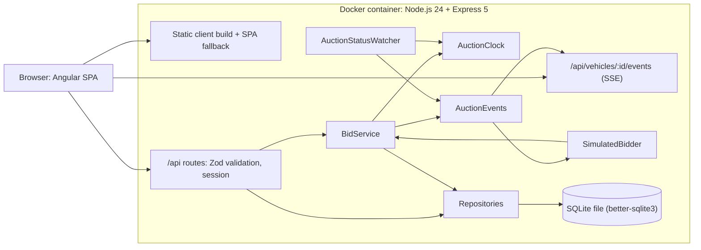

# The Block: System Design (Final Draft)

**Status:** Final draft. All review findings (F1–F25) have been resolved; implementation proceeds by tier (§3.1). **P0, P1, and P2 are built; P2 is awaiting review.** Details refined during implementation are reflected in this document.
**Last updated:** 2026-10-31
**Supersedes:** `system-design-baseline-doc.txt`
**Review addressed:** `system-design-proposal-analysis.md`

---

## 1. Project Summary

The Block is a web application that models the buyer side of a wholesale vehicle auction platform. It is a prototype built for the OPENLANE coding challenge, not a production launch.

Buyers can browse and search an inventory of 200 vehicles, inspect each vehicle's specs, condition, damage notes, selling dealership, and photos, and place bids. The server validates every bid, and the UI immediately shows the result. §3 and §7 list everything beyond this core experience, along with its priority.

**Visual design.** The UI closely follows OPENLANE's color palette and layout conventions, so the experience feels familiar to reviewers. It carries the project's own name, "The Block", and uses no OPENLANE logo, wordmark, or other trademarks. Colors taken from the brand are checked against WCAG 2.2 AA contrast requirements (§10).

**Scale.** The prototype runs on a fixed dataset of 200 vehicles. §16 describes what would have to change to support production volumes of thousands of vehicles per day.

## 2. Goals, Constraints, and Assumptions

### Goals

- Meet the challenge's minimum bar:
  - inventory browsing and search;
  - a clear vehicle detail view;
  - a bid flow with updated visible state;
  - a usable experience on desktop and mobile;
  - a repo that runs by following the README.
- Make bidding correct and trustworthy: the server validates every bid, retries are safe, and buyers can always see where they stand.

### Constraints

- **Time box.** The brief asks for 3–4 hours of work. §3 sets priorities and a cut line against this budget.
- **Prototype, not production.** §16 describes what would change for production.
- **Fixed dataset.** 200 synthetic vehicles in `data/vehicles.json`.

### Dataset assumptions

| Observation | Assumption |
|---|---|
| 112 of 200 vehicles have no bids (`current_bid` is null and `bid_count` is 0) | The first bid on these vehicles must be at least `starting_bid` |
| 60 vehicles have no `reserve_price` | These are "No reserve" auctions: any bid can win |
| 39 vehicles have a `buy_now_price` | Buy Now is offered on these vehicles (§8.5) |
| `auction_start` values span 2026-03-31 to 2026-04-06, have no timezone, and no end time is given | Times are recalculated relative to the server's clock when the data is seeded, and every auction gets a fixed duration (§8.4). After this recalculation, the original timezone does not matter |
| Prices are whole numbers, and every vehicle is in a Canadian province | Money is CAD, stored as whole dollars |
| `current_bid` and `bid_count` describe bidding that happened before the data begins | These values are loaded as each auction's starting state. The individual earlier bids and bidders are unknown (§11) |
| Image URLs point to placehold.co | Images need network access. The UI shows a fallback when an image fails to load |

## 3. Scope

### 3.1 Priorities and cut line

| Tier | Contents | Rough effort |
|---|---|---|
| **P0: minimum bar** | <ul><li>Monorepo with SQLite schema, seed, and auction schedule (§6.4, §8.4)</li><li>Inventory: text search, auction status filter, sorting, numbered pages, state in the URL (§7.1)</li><li>Vehicle detail (§7.2)</li><li>Header sign-in (§7.4)</li><li>The bid flow: the rules in §8.3 with unit tests, idempotency, price-changed handling, confirmation, updated visible state</li><li>Responsive layout (§9)</li><li>README with the `npm run dev` path (§15)</li></ul> | ~4–6 h |
| **P1** | <ul><li>Bid endpoint integration tests (§14)</li><li>My Bids (§7.5)</li><li>Buy Now (§8.5)</li><li>The remaining filters (§7.1)</li><li>Docker single container (§15)</li></ul> | ~2–3 h |
| **P2** | <ul><li>SSE live updates and the simulated bidder (§6.1, §6.2)</li><li>Favorites (§7.6)</li><li>Visual polish toward the OPENLANE palette (§1)</li><li>Playwright end-to-end test (§14)</li></ul> | ~3–4 h |

The effort figures are rough estimates assuming AI-assisted development.

**Time box.** The brief's 3–4 hour budget ends partway through P0. Going past it is a deliberate choice, which the brief permits ("that's your call"), and the README reports the actual time spent and the tier reached (D24).

**Delivery process (tier gates):**

1. Tiers are built strictly in order.
2. At the end of each tier, work stops. The project must build (`npm run build`), pass lint and tests (`npm run lint`, `npm test`), and run (`npm run dev`, and also `docker compose up --build` from P1 onward).
3. The next tier starts only after the author has run the app, reviewed progress, and explicitly approved continuing.
4. Anything in a tier that was not reached stays documented in this design as designed but not built, and the README says so.

### 3.2 Out of scope (non-goals)

| Non-goal | Reason |
|---|---|
| Credential-based authentication, registration, account management | The brief does not require accounts. A demo identity covers what is needed (§7.4) |
| Checkout and payment | Excluded by the brief. Auction wins and Buy Now purchases record the outcome only |
| Seller workflows | Excluded by the brief |
| Dealer admin tooling | Excluded by the brief |
| Proxy (maximum) bidding | Requires hidden-maximum logic and its own set of tests. D14 explains how its absence shapes the self-raise rule |
| Anti-sniping extensions | Moving end times complicates countdowns, the simulated bidder, and tests. Fixed end times keep the demo predictable |
| Bid retraction | Bids are binding commitments. Allowing retraction would need a policy and moderation |
| Post-sale settlement (transport, title transfer, arbitration) | Happens after the auction, outside the buyer's bidding experience |
| Email and push notifications | Would require external services. Outbid feedback is shown in the app instead (§6.1, §7.5) |
| More than one real buyer | There is one seeded demo buyer. Competition comes from the simulated bidder (§6.2) |
| Keeping data past a re-seed | Re-seeding is what keeps the demo usable (§8.4) |
| Server-side rendering and SEO | A buyer portal does not need search-engine indexing |
| Languages other than English, currencies other than CAD | The dataset is Canadian, and a single locale keeps formatting simple |
| Offline support | Vehicle images are served from placehold.co |

## 4. Tech Stack

| Layer | Choice | Notes |
|---|---|---|
| Frontend | Angular v22, TypeScript (strict), RxJS | Built with the Angular CLI's esbuild-based `application` builder. Component state is exposed as RxJS observables and rendered with the `async` pipe; Signals are not the primary state mechanism |
| UI components | Angular Material (Material 3), themed | Themed with the OPENLANE-derived palette, using component token overrides where Material's default look differs. See §13.5 |
| Runtime | Node.js 24 LTS | Angular 22.2 supports Node `^22.22.3`, `^24.15.0`, or `>=26`; the project uses 24.22 |
| Backend | Express 5, TypeScript (strict) | Express 5 forwards errors from `async` route handlers to the error middleware. Request bodies are validated with Zod before they reach a handler |
| Shared contracts | `shared` workspace package | Zod schemas for every API request and response. The server validates against them, and the client and server both use the TypeScript types inferred from them, so the API contract is defined in one place |
| Persistence | SQLite via `better-sqlite3` | Synchronous driver with prebuilt binaries for current Node LTS versions. See §6.4 |
| Testing | Vitest, Supertest, Playwright | Vitest runs on the client (through the Angular CLI) and on the server. Supertest covers HTTP-level server tests. See §14 |
| Packaging | Docker (single image) + Docker Compose | Express serves both the built Angular app and the API. A non-Docker `npm run dev` path is also provided. See §15 |

**Repository layout.** A single repository using npm workspaces: `client/` (Angular), `server/` (Express), and `shared/` (API contracts). One `npm install` at the root installs all three.

**Change detection rule.** New Angular projects may be generated without zone.js, Angular's automatic change detection. In that case, the template only re-renders when Angular is notified of a change. Codebase rule: anything that drives a template is bound through the `async` pipe, and values are never assigned to component fields inside a manual `.subscribe()`. This keeps the RxJS-centric style correct whether or not zone.js is present.

### 4.1 Why Angular

- **Familiarity.** Angular with RxJS is the stack I have the most production experience with, so I can explain and defend every part of the codebase in the walkthrough.
- **Batteries included.** The router, `HttpClient` (with interceptors), Reactive Forms, and RxJS ship with Angular and are maintained together. Within a 3–4 hour budget, not having to choose and wire up separate libraries for each concern is a real saving.
- **RxJS fits this app's asynchronous work.**
  - *Search:* `debounceTime` + `distinctUntilChanged` + `switchMap` cancels stale in-flight requests, so results never arrive out of order.
  - *Live auction state:* the initial `GET` and the Server-Sent Events stream (§6.1) combine into one Observable that the template renders through the `async` pipe.
  - *Countdowns:* derived from the server clock with a timer, not from the device clock.
  - *Retries:* idempotent reads are retried with backoff using `retry({ count, delay })`. Bid submissions are retried only when they carry an idempotency key (§12).
- **Alternatives considered.** React + Vite, the brief's example stack, would fit just as well. Libraries such as TanStack Query and React Hook Form provide the same capabilities. The deciding factors are familiarity and not having to assemble a stack, not a capability gap.
- **Server-side rendering (SSR) was not a factor.** The app is a buyer portal with no search-engine indexing requirements, so SSR is not used.

## 5. Decision Log

| # | Decision | Alternatives considered | Rationale |
|---|---|---|---|
| D1 | Closely match OPENLANE's palette and layout, branded as "The Block", with no OPENLANE logo or wordmark | Use OPENLANE's style only as loose inspiration; fully replicate it, logo included | A familiar look helps reviewers orient quickly. Leaving out the logo and wordmark avoids reproducing another company's trademarks in a public repo. Visual polish comes after the bid flow works (§3) |
| D2 | Angular v22, written in an RxJS-centric style | Angular v16 (most familiar, but end-of-life since Nov 2024 and limited to end-of-life Node 16/18); React + Vite (the brief's example stack); Signals-first Angular | A supported version gets security patches and runs on a supported Node.js. Signals are optional in current Angular, so the familiar RxJS / `async` pipe style still works. The esbuild builder and standalone components come by default |
| D3 | Server-Sent Events for live auction updates; bids are still placed with `POST` | WebSockets (Socket.io); polling with an RxJS timer; no live updates | Updates flow only from server to client. SSE is plain HTTP, reconnects automatically, needs no extra library on either side, and needs no proxy configuration. Sending full snapshots makes reconnecting trivial |
| D4 | A reactive simulated bidder, with a switch to turn it off and a dev-only endpoint to force a counter-bid | Random bids on a background timer; a manual demo button; no simulation | It behaves like a real rival who responds to being outbid, so the outbid state appears while the reviewer is watching. The ceiling guarantees the buyer can win. The switch and the endpoint keep tests and the walkthrough predictable |
| D5 | A backend is the source of truth for bids, time, and auction state | Frontend-only, with bids kept in browser storage (the brief allows this) | Whether a bid is accepted must not be up to the client. The server owns the clock, so the device clock cannot skew countdowns or auction status. SSE and the simulated bidder need a server process |
| D6 | Express 5 + TypeScript, with Zod contracts shared through an npm-workspaces monorepo | NestJS (Angular-style dependency injection, but more boilerplate); Fastify; plain JavaScript | Express is minimal and familiar, and v5 fixes error handling in `async` handlers. With TypeScript on both sides and one set of schemas, a client/server contract mismatch becomes a compile error instead of a runtime bug |
| D7 | SQLite file database | In-memory store seeded at startup; a JSON file (e.g., lowdb) | Real transactions make bid acceptance atomic, with rollback on error, which is closer to the production design. State survives restarts, and tests get a fresh in-memory database per file. The cost: a schema and seed script, a reset command, and stored state that can conflict with auction times calculated relative to "now" (§8) |
| D8 | `better-sqlite3` as the SQLite driver | Node's built-in `node:sqlite` (no install step, but its API was still marked experimental at the time of writing) | Mature and widely used. Its synchronous API keeps the transaction code simple, and prebuilt binaries mean no compile step on current Node LTS versions |
| D9 | Vitest across the whole monorepo | Jest (the baseline's choice); Vitest on the client with Jest on the server | Vitest is the current Angular CLI's default unit-test runner, while Angular's Jest integration was only experimental. One runner and one assertion API for client and server |
| D10 | A single container in which Express serves both the Angular build and the API | Two Compose services with nginx in front; Compose running the dev servers | The fewest moving parts for "clone and run": one image and one port. Client and API share an origin, so there is no CORS setup and no proxy configuration for SSE. Production would separate them (§16) |
| D11 | Increments in price tiers: $100 under $10,000, $250 from $10,000 to $29,999, and $500 from $30,000 | A fixed $100; a fixed $250 | Increments that scale with price are standard practice (eBay, for example, [ties increments to the current price](https://pages.ebay.co.uk/help/buy/bid-increments.html)). They keep each step proportional to the price and keep bidding wars on expensive vehicles short. The specific numbers are deliberately simple round values, chosen so they are easy to explain in a demo. They are not calibrated to any real platform's increment table |
| D12 | The auction schedule is anchored when the data is seeded and persisted, with an automatic re-seed when no auction is live or upcoming | Re-seeding on every start; recalculating times on every start while keeping bids | Persisted bids stay consistent with their auctions, and a reviewer never starts the app in a marketplace where every auction has ended |
| D13 | Full Buy Now: buying ends the auction immediately as a sale to the buyer, without checkout | Hide the Buy Now price; display it without an action | Included to replicate a real auction app's workflow more fully: the dataset carries Buy Now prices, and buyers on auction platforms can choose between bidding and buying outright. Checkout and payment remain out of scope; the purchase is recorded and the auction closes |
| D14 | The current high bidder cannot place another bid (`ALREADY_HIGH_BIDDER`) | Accept the bid like any other | Without proxy bidding, raising your own bid only increases the price you will pay. Major auction platforms such as eBay do not let a high bidder push the visible price up against themselves; instead, the bidder can raise a hidden maximum bid that the platform bids up to automatically. This app has no proxy bidding (a non-goal), so rejecting the bid is the equivalent behaviour |
| D15 | Anyone can browse. A header "Sign in" button signs the user in as the Demo Buyer, and bidding, Buy Now, and favorites require sign-in | A session created automatically on first load, with no button; a login page in front of the whole app; a switcher between two demo buyers | This matches how real auction apps work: browse freely, sign in to act. It keeps a visible, explainable sign-in step without blocking reviewers from the inventory. It also resolves the baseline's contradiction: credentials and accounts are out of scope, but identity is in scope. A real login form would go in the sign-in dialog. The session is a cookie because `EventSource` cannot send headers |
| D16 | Filtering and numbered paging (24 per page) happen on the server | Filtering the full list in the browser; infinite scroll; a "Load more" button | The API has the same shape it would need in production, so the scale discussion in §16 needs no redesign, and list responses stay small. Numbered pages keep the URL an exact record of the view, so back, forward, and shared links restore it. Numbered pages are also more accessible than infinite scroll |
| D17 | A compact search bar is always pinned to the top. Filters open in a drawer on mobile and sit in a sidebar on desktop | The full search and filter bar pinned at every screen size (the baseline's plan); hiding the bar when scrolling down | The search bar itself is always visible. On mobile, filters open in a drawer to save space and avoid visual clutter, which is a common mobile pattern. This keeps the baseline's intent (search is always within reach) without letting the bar take over a phone screen |
| D18 | A bid placed against a price that has since changed is rejected (`PRICE_CHANGED`), even if it still meets the new minimum | Accept any bid that meets the minimum when it arrives | A buyer only ever commits a bid against the price they are looking at. If another bidder acts while the confirmation is open, the buyer sees the new price and decides again. This gives a smoother, less confusing experience: no buyer confirms a bid expecting to become the high bidder, only to find that another bidder's activity changed the outcome before it was placed |
| D19 | An `Idempotency-Key` is required on bid and Buy Now requests | An optional key | Retries are safe by construction, so a timeout followed by a retry can never place a bid twice. The app's own client is the only caller, so requiring the key costs nothing. Storing the key in the same transaction as the write makes it exactly-once |
| D20 | RFC 9457 Problem Details for errors | A custom `{ error: { code, message } }` envelope | A standard, documented format. One `HttpClient` interceptor can handle every error the same way. Extension members carry the stable `code` and, on 409 responses, the latest auction state, so the UI can update directly from the error |
| D21 | The dataset's `current_bid` and `bid_count` become each auction's starting state, and only bids placed in the app are stored | Generate earlier bid rows synthetically; reset every auction to no bids | Keeps the dataset's realism (88 vehicles show active bidding) without inventing records. As a result, there is no bid-history endpoint, and an earlier high bidder appears as "another bidder" |
| D22 | Client state lives in services that hold RxJS `BehaviorSubject`s and expose Observables | NgRx Store with Effects; NgRx ComponentStore | The app has four pages, and most of its state is owned elsewhere: the URL owns search state, and the server owns auction state. A store library would add ceremony without solving a problem this app has |
| D23 | Angular Material (Material 3), themed | Angular CDK with custom SCSS; Tailwind with the CDK | The fastest way, within the time box, to get accessible and consistent components (dialogs, drawers, form fields, tabs) with focus management built in. A theme plus token overrides bring it close to the OPENLANE look. The trade-offs: Material's default look must be overridden in places, and numbered pagination needs a small custom component |
| D24 | Build in tier order, stop for review after each tier, and go past the time box deliberately while reporting it | Stop strictly at 3–4 hours; shrink P0 to fit | The design is larger than the brief's budget. Building in priority order means the most important work is always done first. Ending every tier in a buildable, runnable state means the author can review progress, and work can stop at any tier with a working app. Reporting the actual time openly demonstrates judgment |

## 6. Architecture Overview



A single Node.js process serves everything from one origin: the static Angular build, the JSON API, and the SSE streams. The bid service is the only code path that writes bids. The simulated bidder is one of its callers, alongside the HTTP routes.

### 6.1 Live updates (Server-Sent Events)

The vehicle detail page receives auction updates over a Server-Sent Events (SSE) stream at `GET /api/vehicles/:vehicleId/events`.

- **Server side.** The bid service publishes an internal event whenever it accepts a bid, whether from a real buyer or the simulated bidder (§6.2). It also publishes one whenever an auction changes state (`upcoming` → `live` → `ended`). Each open stream forwards only the events for its own vehicle.
- **Snapshots, not deltas.** Every event carries the vehicle's complete auction state: current bid, bid count, minimum next bid, status, end time, and whether the viewer is the high bidder. The first event on every new connection is the current state, so a reconnecting client is correct as soon as it receives one event, and the server never has to replay missed events.
- **Per-viewer payloads.** Whether the viewer is the high bidder depends on who is watching, so the server builds each payload from that connection's session. `EventSource` cannot set custom request headers, so the session is carried in a cookie (§7.4). Signed-out viewers receive the same stream without the high-bidder field.
- **Keep-alive.** The server writes an SSE comment line every 20 seconds so proxies don't close idle connections. The server uses no response-compression middleware, which would buffer the stream and delay events, and it sends `X-Accel-Buffering: no` for reverse proxies such as nginx.
- **Client side.** A small utility wraps `EventSource` in an Observable, and unsubscribing closes the connection. The browser reconnects a dropped stream by itself; a refused stream (for example a 404) is retried with backoff, from 1 second up to 30. The detail page combines the initial `GET` with the stream and renders the latest state through the `async` pipe. Because payloads are per viewer, the stream is reopened when the buyer signs in or out.
- **One stream per detail page.** List pages never open streams. Browsers allow about six HTTP/1.1 connections per origin, and a stream per card would starve other requests.
- **Works without the stream.** The `POST` bid response also returns the full auction state, so the buyer's own bids display correctly even if the stream is unavailable or not yet built. SSE adds other bidders' activity; the core bid flow does not depend on it.

### 6.2 Simulated competing bidder

The demo has a single real buyer, so a server-side simulated bidder supplies competition and makes the outbid state demonstrable.

- **Same code path.** The simulator places bids through the same bid service as real buyers, with the same validation, concurrency handling, and events. It is a client of the bid service, not a back door into the store.
- **Identity.** A seeded user (`sim-bidder-1`), shown to buyers as "Another bidder".
- **Trigger.** When a real buyer's bid is accepted on a live auction, the simulator schedules one counter-bid after a random delay of 3–10 seconds.
- **Checks before bidding.** When the timer fires, the simulator bids only if all of the following still hold:
  - the auction is still live;
  - the real buyer is still the high bidder;
  - the minimum next bid does not exceed the vehicle's ceiling.

  Pending timers are cancelled when an auction ends.
- **Amount.** Always the minimum next bid.
- **Ceiling.** At startup, each vehicle gets a hidden maximum price, drawn from a seeded random generator within a configurable band (2–15% by default) above its reserve price (or above its current or starting bid if there is no reserve). Each vehicle's draw depends only on the seed and its ID, so ceilings are the same on every start. Once the price passes the ceiling, the simulator stops bidding and the real buyer can win.
- **Override (walkthrough only).** `POST /api/dev/vehicles/:vehicleId/simulate-bid` places an immediate counter-bid at the minimum next bid, ignoring the ceiling. This route exists only when `ENABLE_DEV_ENDPOINTS` is true, and it is not part of the public API (§12).
- **Testability.** The seed, the delay range, the ceiling band, and the clock are injected, so tests run with a fixed seed and fake timers. The end-to-end tests turn the automatic counter-bids off and trigger the rival through the override endpoint instead.

| Variable | Default | Purpose |
|---|---|---|
| `SIM_BIDDER_ENABLED` | `true` in dev and Docker, `false` in tests | Turns the simulator on or off |
| `SIM_BIDDER_SEED` | `the-block` | Makes ceilings and delays reproducible |
| `SIM_BIDDER_DELAY_MS` | `3000-10000` | Counter-bid delay range |
| `ENABLE_DEV_ENDPOINTS` | `true` outside production | Registers the override endpoint |

§3 decides the delivery priority of §6.1 and §6.2.

### 6.3 Server components

| Component | Responsibility |
|---|---|
| Routes and controllers | HTTP only: validate input against the shared Zod schemas, resolve the session user, call a service, and map the result to a response DTO |
| `BidService` | Accepts or rejects bids and Buy Now purchases under the rules in §8, performs each write in one transaction, and publishes the resulting auction state. Both operations live here because they share the same validation, transaction, and event path |
| `AuctionClock` | The single source of "now" and of each auction's status (`upcoming`, `live`, `ended`). It is injectable, so tests control time |
| `AuctionStatusWatcher` | Sets one timer for the next auction start or end, then publishes each status change through `AuctionEvents` (§8.4). It wakes at least once a minute, so a long wait never drifts from the clock |
| `AuctionEvents` | In-process publish/subscribe for auction state changes. It feeds the SSE streams (§6.1) and the simulated bidder (§6.2) |
| `SimulatedBidder` | Described in §6.2. It subscribes to `AuctionEvents` and places bids through `BidService` |
| Repositories | `VehicleRepository`, `BidRepository`, `FavoriteRepository`, and `UserRepository`. All SQL lives here |

Services depend on the repository interfaces, never on SQLite directly.

### 6.4 Persistence (SQLite)

- **Location and lifecycle.** The database file is `server/data/the-block.db`, which is gitignored. On startup, if the database is new, or its schema version (`PRAGMA user_version`) differs from the code's, the server rebuilds the schema and seeds it from `data/vehicles.json`. `npm run db:reset` rebuilds and re-seeds it immediately.
- **Data access.** Plain SQL with prepared statements, used only inside the repositories. There is no ORM, because the schema has only a handful of tables.
- **WAL mode.** Write-ahead logging is enabled, so writes do not block reads.
- **Bid transactions.** Accepting a bid happens in one `BEGIN IMMEDIATE` transaction, which:
  1. reads the vehicle's auction state;
  2. validates the bid;
  3. inserts the bid row;
  4. updates the vehicle's `current_bid`, `bid_count`, and `version`.

  Any failure rolls back the whole transaction. The driver is synchronous and the server is a single process, so two bids can never interleave, and the transaction makes each bid all-or-nothing.
- **Tests** open a fresh `:memory:` database for each test file, so they are fast and isolated.
- **Docker.** The data directory is mounted on a named volume, so data survives container restarts. `docker compose down -v` resets it (§15).
- **Auction times.** The schedule is anchored when the data is seeded and stored with it. §8.4 describes the automatic re-seed.

## 7. Functional Requirements

### 7.1 Browse and search

- **Free-text search** over year, make, model, trim, VIN, and lot number. It is case-insensitive, and every whitespace-separated term must match at least one of those fields. For example, `2023 mazda` matches vehicles with year 2023 *and* "mazda" in the make.
- **Filters:**

| Filter | Type | Values |
|---|---|---|
| Make | Multi-select | Values from the dataset |
| Body style | Multi-select | Values from the dataset |
| Province | Multi-select | Values from the dataset |
| Year | Range | Minimum and maximum |
| Price | Range | Current price: the current bid, or the starting bid if there are no bids |
| Condition grade | Minimum | Grade threshold |
| Title status | Multi-select | Clean, rebuilt, salvage |
| Auction status | Multi-select | Live, upcoming, ended. The default is live and upcoming |
| Buy Now available | Toggle | Only vehicles where Buy Now is currently offered (§8.5) |

- **Sorting:** ending soonest (the default; ended auctions sort last), price low to high, price high to low, newest year, and lowest odometer.
- **Paging:** numbered pages of 24 vehicles each. 24 fills complete rows at two, three, or four columns. Changing the search, a filter, or the sort returns to page 1.
- **State in the URL.** The search text, filters, sort, and page are all stored in query parameters, so the back and forward buttons and shared links restore exactly what was on screen.
- **Request handling.** Typing in the search box waits 300 ms after the last keystroke, and a new request cancels any request still in flight (`debounceTime` + `switchMap`), so results never arrive out of order. Filtering and paging happen on the server (§12).
- **Vehicle card.** Shows:
  - a photo;
  - year, make, model, and trim;
  - lot number;
  - odometer;
  - city and province;
  - condition grade;
  - title status (rebuilt and salvage titles are highlighted);
  - current or starting bid, and bid count;
  - auction status with a countdown;
  - a Buy Now badge where available;
  - a favorite toggle.
- **Empty state.** "No vehicles match" with a "Clear filters" action.

### 7.2 Vehicle detail

- **Identity:** year, make, model, trim, VIN, lot, selling dealership, city, and province.
- **Specs:** engine, transmission, drivetrain, fuel type, odometer (km), body style, and exterior and interior colors.
- **Condition:** grade, condition report, damage notes, and title status. A rebuilt or salvage title is prominently flagged, because title status is a key fact for buyers deciding whether to trust a listing.
- **Photos:** a gallery of all of the vehicle's images, with a fallback when an image fails to load.
- **Auction:** the bid panel (§8.7), Buy Now where offered (§8.5), and live updates (§6.1).

### 7.3 Bidding and Buy Now

Specified in full in §8.

### 7.4 Identity

- **Browsing is open to everyone.** Search, vehicle detail, and live updates work without signing in.
- **Signing in.** A "Sign in" button in the header opens a dialog: *"This is a demo, so accounts and passwords aren't implemented. Continue as Demo Buyer?"* Confirming calls `POST /api/session`.
- **Actions that require sign-in:** placing a bid, Buy Now, toggling a favorite, and opening My Bids or Favorites. When the buyer is signed out, each of these opens the same dialog. After sign-in, the original action continues: the bid panel keeps the amount already entered, and navigation resumes at the requested page.
- **Signed-in header.** Shows "Demo Buyer" and a "Sign out" button, which calls `DELETE /api/session`.
- **Session mechanics:**
  - **Creation.** The server generates a random 256-bit session ID, stores it in a `sessions` table that maps it to the seeded buyer, and sets it as a cookie: `sid`, with `HttpOnly`, `SameSite=Lax`, and `Path=/`. `Secure` is added when the app is served over HTTPS; local HTTP leaves it off.
  - **Restoring state.** On startup the app calls `GET /api/session`, which always returns 200 with `{ user }` (null when signed out). Being signed out is a normal state, so a signed-out visit logs no 401 errors in the browser console. `GET /api/me` still returns 401 when signed out, like every endpoint that requires sign-in.
  - **Unauthenticated requests.** A request to an endpoint that requires sign-in, made without a valid session, returns 401 `AUTH_REQUIRED`. An HTTP interceptor responds by opening the sign-in dialog.
  - **Protected routes.** A route guard on `/my-bids` and `/favorites` opens the dialog. If the buyer dismisses it, they return to the inventory.
  - **Re-seeding** clears all sessions. The client receives a 401 and shows the signed-out state.
- **Why a cookie.** `EventSource` cannot send custom headers, so the SSE stream can only identify the viewer through a cookie (§6.1).
- **CSRF.** The browser attaches session cookies automatically, so state-changing endpoints need cross-site request forgery (CSRF) protection. Two measures provide it for the demo:
  - `SameSite=Lax` stops browsers from sending the cookie with cross-site `POST`, `PUT`, and `DELETE` requests;
  - the API accepts only `application/json` request bodies, which a cross-site HTML form cannot send.
- **Out of scope:** credentials, registration, password reset, and account management. There is one seeded buyer ("Demo Buyer"). The simulated bidder is a separate seeded user that cannot sign in.

### 7.5 My Bids

- **Route:** `/my-bids`. Requires sign-in.
- **Tabs.** *Active* holds live auctions the buyer has bid on. *Ended* holds finished auctions the buyer bid on, plus Buy Now purchases.
- **Row:**
  - a photo, plus year, make, model, and lot;
  - the buyer's highest bid (shown as "—" for a Buy Now purchase made without bidding);
  - the current or final price;
  - a status;
  - time remaining (Active) or end time (Ended).
- **Statuses:**

| Status | Tab | Meaning |
|---|---|---|
| Winning | Active | The buyer is the current high bidder |
| Outbid | Active | Someone else holds the high bid |
| Won | Ended | The auction ended as a sale to the buyer |
| Lost | Ended | The auction ended and the buyer was not the high bidder |
| Reserve not met | Ended | The buyer was the high bidder, but the reserve was not met, so there was no sale |
| Purchased | Ended | The buyer bought the vehicle through Buy Now |

- **Ordering:** Active rows by ending soonest; Ended rows by most recent first.
- **Data and freshness.** One request (`GET /api/me/bids`) returns every row with its vehicle summary embedded, and the server computes the statuses. The page does not open SSE streams (§6.1); while the Active tab is open, it re-fetches every 30 seconds.

### 7.6 Favorites

- **Toggling.** A heart toggle on vehicle cards and on the detail page. It requires sign-in.
- **Updates before the server confirms.** The heart changes immediately and reverts if the request fails. This is acceptable for favorites because they are low-stakes and easily reversed, unlike bids (§8.7).
- **Route:** `/favorites` lists favorited vehicles as cards showing their current auction status, ending soonest first and ended auctions last. A card whose heart is cleared on this page stays until the page is reloaded, so the change is one click to undo.
- **Signing in from a heart** finishes the favorite the buyer asked for, and the inventory reloads its current page quietly (without skeletons), so the buyer's other favorites show.
- **Card structure.** The card's title link stretches over the whole card, and the heart is a separate button above it. A button inside a link is invalid HTML and is announced confusingly by screen readers.

§3 sets the delivery priority.

## 8. Bidding Rules

### 8.1 Money

All amounts are in CAD and are stored, sent over the API, and handled in the client as whole dollars. Money is never handled as floating point. The client formats amounts with `Intl.NumberFormat('en-CA', { style: 'currency', currency: 'CAD', maximumFractionDigits: 0 })`.

### 8.2 Increments and the minimum next bid

| Current price | Increment |
|---|---|
| Under $10,000 | $100 |
| $10,000 – $29,999 | $250 |
| $30,000 and above | $500 |

- **Minimum next bid:**
  - if the vehicle has no bids yet: its `starting_bid`;
  - otherwise: the current bid plus the increment for the current bid's tier.

  For example, a current bid of $9,900 gives a minimum of $10,000; a current bid of $10,000 gives a minimum of $10,250.
- **The server is the only place this is calculated.** The API returns `minNextBid`, so the client never computes it.

### 8.3 Bid acceptance

The server runs the checks below in order, and the first one that fails determines the response. Every rejection has a stable error code (§12), and every 409 response includes the latest auction state.

| Order | Check | Rejection |
|---|---|---|
| 1 | The request body is valid: `amount` is a positive whole number, and `expectedCurrentBid` is a whole number or null | 422 `VALIDATION_FAILED` |
| 2 | The amount is no more than $1,000,000 (a sanity limit that catches typos) | 422 `BID_TOO_HIGH` |
| 3 | The auction's status is `live` | 409 `AUCTION_NOT_LIVE` |
| 4 | The current bid still equals `expectedCurrentBid`, the price the buyer confirmed against (D18) | 409 `PRICE_CHANGED` |
| 5 | The bidder is not already the high bidder (D14) | 409 `ALREADY_HIGH_BIDDER` |
| 6 | The amount is at least `minNextBid` | 409 `BID_TOO_LOW` |

### 8.4 Auction schedule

- **Mapping.** When the database is seeded at time T, each `auction_start` from the dataset is mapped onto the window from T − 4h to T + 4h. The mapping is linear, so the original order is preserved. Every auction lasts 3 hours (`auction_end = auction_start + 3h`). Both times are stored in UTC.
- **Resulting spread.** Right after seeding, about 1/8 of the auctions have already ended, about 3/8 are live, and about half are upcoming. Over the next 7 hours they progress until every auction has ended.
- **Status.** `AuctionClock` derives each auction's status:
  - `upcoming` before its start;
  - `live` from its start until its end;
  - `ended` once it reaches its end, or as soon as it is bought through Buy Now.

  `AuctionStatusWatcher` sets one timer for the next start or end across all auctions and publishes each change through `AuctionEvents`, so SSE clients and the simulated bidder see an auction go live or end without polling.
- **Automatic re-seed.** On startup, if no auction is live or upcoming, the server rebuilds the database from the dataset and logs that it did so. `npm run db:reset` forces a re-seed at any time. Re-seeding discards demo bids, purchases, and favorites. The README says so.
- **Countdowns.** The client computes countdowns from `auctionEnd` and the `serverTime` included in each response, correcting for any difference between the device clock and the server clock.

### 8.5 Buy Now

- **Availability.** Buy Now is offered only when all of the following hold:
  - the vehicle has a `buy_now_price`;
  - its auction is `live`;
  - the current bid is below the Buy Now price.

  Once bidding reaches the Buy Now price, Buy Now is withdrawn.
- **Action.** After a confirmation step showing the price, the client calls `POST /api/vehicles/:vehicleId/buy-now` with an idempotency key.
- **Effect.** A single transaction:
  1. ends the auction immediately;
  2. records the vehicle as sold to the buyer at the Buy Now price;
  3. cancels the simulated bidder's pending counter-bids;
  4. publishes the final state over SSE.
- **Rejections.**
  - `AUCTION_NOT_LIVE` if the auction is not live (which includes vehicles already sold);
  - `BUY_NOW_UNAVAILABLE` if there is no Buy Now price or bidding has reached it.
- **No checkout.** Checkout and payment stay out of scope. The UI confirms the purchase and shows the vehicle as purchased.

### 8.6 Reserve and auction outcome

- **Reserve.** The reserve amount never leaves the server. The API exposes `reserveStatus`, which is one of `none`, `not_met`, or `met`.
- **Outcome.** When an auction ends, its outcome is decided as follows:

| Condition at the end | Outcome |
|---|---|
| Bought through Buy Now | Sold (Buy Now) |
| At least one bid, and the reserve is met (or there is no reserve) | Sold to the high bidder |
| At least one bid, but the reserve is not met | Reserve not met (no sale) |
| No bids | No sale |

### 8.7 Bidding in the UI

- **Bid panel.** Shows:
  - the current bid and bid count;
  - the minimum next bid;
  - the reserve status;
  - the time remaining;
  - the buyer's position: high bidder, outbid, or not yet bidding.
- **Placing a bid.** The primary button bids the minimum ("Bid $X"). A second field accepts a custom, higher amount.
- **Confirmation.** A confirmation step shows the exact amount before submission. The submit button is disabled while the request is in flight. Nothing is shown as accepted until the server confirms it.
- **On success.** The panel renders the state returned by the server and shows "You're the high bidder". Bidding stays disabled until the buyer is outbid.
- **When a bid is rejected because the price moved** (`BID_TOO_LOW` or `PRICE_CHANGED`), the panel shows the new current bid and the new minimum and stays open so the buyer can bid again.
- **When the buyer is outbid** (received over SSE), the panel shows "You've been outbid" with the rival's amount and the new minimum, the price briefly highlights, and the message is announced to screen readers. When the auction ends while the page is open, the outcome replaces any earlier message.

### 8.8 Not included

- Anti-sniping extensions (moving the end time when a bid arrives in the final seconds);
- proxy (maximum) bidding;
- bid retraction.

All three are listed as non-goals in §3.

## 9. UX Requirements

- **Search bar.** A compact, one-row bar stays pinned to the top of the inventory page at every screen width. It holds the search box and a "Filters (n)" button, where n is the number of active filters.
- **Filters.**
  - *Below 1024px:* filters open in a drawer with "Apply" and "Clear all" buttons. Focus stays inside the drawer while it is open, and Escape closes it.
  - *1024px and wider:* filters sit in a sticky sidebar next to the results, and the "Filters" button is hidden.
- **Header.** A navy brand bar. Below 600px, My Bids and Favorites become icon links, still named for screen readers, so the header fits a 360px screen.
- **Card grid.** One column below 600px, two up to 1023px, three up to 1439px, and four at 1440px and wider. Each width fills complete rows of the 24-vehicle page (§7.1).
- **Visual design.** OPENLANE-derived palette and layout under "The Block" name (§1, D1).
- **Status indicators.**
  - *Chips* for Live, Upcoming, Ended, Sold, and Reserve not met.
  - *Badges* for rebuilt and salvage titles and for Buy Now.
- **Countdowns.** Shown in hours and minutes. Seconds appear in the final 10 minutes.
- **Loading and errors.** Skeleton cards appear while results load. Errors appear inline with a "Retry" action.
- **Dialogs.** Bid confirmation (§8.7), Buy Now confirmation (§8.5), and sign-in (§7.4) all follow the same keyboard and focus rules as the filter drawer.

## 10. Non-Functional Requirements

| Area | Requirement | How it is verified |
|---|---|---|
| Performance | The inventory page meets Google's "good" Core Web Vitals thresholds on a production build: Largest Contentful Paint ≤ 2.5 s, Cumulative Layout Shift ≤ 0.1, and Interaction to Next Paint ≤ 200 ms. Images are lazy-loaded with explicit dimensions (`NgOptimizedImage`). List responses use a summary projection, 24 vehicles per page | Lighthouse with its mobile preset |
| Responsiveness | No horizontal scrolling at 360px, 768px, or 1280px. Tap targets are at least 24×24 CSS px, and primary actions (Bid, Buy Now) are at least 44px | Manual check at each width |
| Accessibility | WCAG 2.2 AA. <ul><li>The bid flow, the dialogs, and the filter drawer work by keyboard alone, with focus kept inside each dialog, Escape to close, and focus returned afterwards.</li><li>Focus is always visible, and every input has a label.</li><li>The palette meets contrast requirements: 4.5:1 for text and 3:1 for UI components. This is checked against the OPENLANE-derived palette.</li><li>Bid results and outbid notices are announced through an `aria-live` region. Countdowns are not announced every second; only status changes are.</li><li>`prefers-reduced-motion` is respected.</li></ul> | Keyboard-only walkthrough, axe DevTools, and a contrast checker |
| Consistency | The server is the single source of truth for price, bid count, auction status, `minNextBid`, and outcome. The client never decides whether a bid is accepted and never computes the minimum next bid | Code review; integration tests (§14) |
| Reliability | Bid and Buy Now requests are safe to retry because they carry idempotency keys (§12). A dropped SSE connection recovers from the first snapshot after reconnecting (§6.1) | Integration tests (§14) |
| Security | <ul><li>Every input is validated with Zod.</li><li>The reserve price is never serialized, because responses are mapped through explicit DTOs.</li><li>CSRF protection as described in §7.4.</li><li>`helmet` sets the security headers.</li><li>SQL is parameterized only.</li><li>Error responses contain no stack traces.</li></ul> | Code review; integration tests check that `reservePrice` is absent from responses |
| Observability | Structured request logs (`pino`) with a request ID on every line. Each bid or Buy Now accept or reject is logged with its outcome code | Inspect the logs during the demo |
| Maintainability | Strict TypeScript, ESLint and Prettier, and shared API contracts (§4) | `npm run lint` and `npm run build` pass |
| Browser support | The latest two versions of Chrome, Edge, Firefox, and Safari, including iOS Safari and Android Chrome | Manual check |

## 11. Data Model

### 11.1 Tables

Column names are snake_case in SQL and camelCase in the API. The repositories map between the two.

```text
vehicles
  id (PK, from the dataset), vin, lot, year, make, model, trim, body_style,
  exterior_color, interior_color, engine, transmission, drivetrain, fuel_type, odometer_km,
  condition_grade, condition_report, damage_notes (JSON array), title_status,
  city, province, selling_dealership, images (JSON array),
  starting_bid, reserve_price (nullable; never serialized), buy_now_price (nullable),
  current_bid (nullable), bid_count, high_bidder_id (nullable → users.id),
  auction_start, auction_end (UTC),
  buy_now_buyer_id (nullable → users.id),
  version (integer; incremented on every auction-state change)

users          id (PK), display_name, kind ('buyer' | 'simulated'), can_sign_in
bids           id (PK, UUID), vehicle_id → vehicles, user_id → users, amount, created_at (UTC)
               indexes: (vehicle_id, created_at), (user_id)
favorites      user_id → users, vehicle_id → vehicles; PK (user_id, vehicle_id)
sessions       id (PK, random 256-bit), user_id → users, created_at
idempotency_keys
               user_id, idempotency_key, endpoint, request_hash, response_status, response_body (JSON), created_at
               PK (user_id, idempotency_key)
```

**Seed data:**
- **Vehicles** are loaded from `data/vehicles.json`. Their schedule is recalculated as described in §8.4.
- **Users:** `demo-buyer` ("Demo Buyer", can sign in) and `sim-bidder-1` ("Another bidder", simulated, cannot sign in).
- **Earlier bidding (D21).** Each vehicle's `current_bid` and `bid_count` from the dataset become its starting auction state, with `high_bidder_id` left null. A null high bidder alongside a non-null current bid means an earlier, unknown bidder, shown as "another bidder". The `bids` table holds only bids placed in the app, so there is no bid-history endpoint (§12).

### 11.2 Invariants

- `current_bid` is null if and only if `bid_count` is 0.
- **Accepting a bid** happens in one transaction that:
  - checks the rules in §8.3;
  - inserts the bid;
  - sets `current_bid` to the amount;
  - increments `bid_count`;
  - sets `high_bidder_id` to the bidder;
  - increments `version`;
  - stores the idempotency record.
- **A Buy Now purchase** happens in one transaction that sets `buy_now_buyer_id`, sets `auction_end` to now, increments `version`, and stores the idempotency record. It is allowed only under the conditions in §8.5.
- `reserve_price` never leaves the repository layer. Responses are built from explicit DTOs (§11.4).

### 11.3 Deriving the outcome

The outcome is derived in one place, from the stored state and the clock, rather than stored:

1. If `buy_now_buyer_id` is set: sold through Buy Now to that buyer, at the Buy Now price.
2. Otherwise, if the end time has not been reached: not ended (the status is `upcoming` or `live`).
3. Otherwise, if `bid_count` is 0: no sale.
4. Otherwise, if there is no reserve or `current_bid` ≥ `reserve_price`: sold to the high bidder (or to an earlier, unknown bidder if `high_bidder_id` is null).
5. Otherwise: reserve not met.

### 11.4 Response DTOs (Zod schemas in `shared`)

| DTO | Fields |
|---|---|
| `AuctionState` | `status`, `auctionStart`, `auctionEnd`, `startingBid`, `currentBid`, `bidCount`, `minNextBid`, `reserveStatus` (`none`, `not_met`, or `met`), `buyNowPrice`, `buyNowAvailable`, `outcome` (`sold`, `sold_buy_now`, `reserve_not_met`, `no_sale`, or null), `viewer` (`{ isHighBidder, hasBid, purchased }`, or null when signed out; `purchased` is true when the viewer bought the vehicle through Buy Now), `version`, `serverTime` |
| `VehicleSummary` | `id`, `lot`, `year`, `make`, `model`, `trim`, `bodyStyle`, `odometerKm`, `city`, `province`, `conditionGrade`, `titleStatus`, `thumbnailUrl`, `isFavorite` (when signed in), `auction: AuctionState` |
| `VehicleDetail` | Everything in `VehicleSummary`, plus `vin`, `exteriorColor`, `interiorColor`, `engine`, `transmission`, `drivetrain`, `fuelType`, `conditionReport`, `damageNotes`, `images`, `sellingDealership` |
| `MyBidRow` | `vehicle: VehicleSummary`, `myHighestBid` (null for a Buy Now purchase made without bidding), `price` (current or final), `status` (`winning`, `outbid`, `won`, `lost`, `reserve_not_met`, or `purchased`) |
| `User` | `id`, `displayName` |

### 11.5 Vehicle versus listing

The dataset merges the *vehicle* (the physical asset) and the *listing* (one auction of that vehicle). In production these would be separate entities, because a vehicle that does not sell can be relisted in a later auction, carrying its own history. Keeping them merged is the right trade-off for a prototype in which every vehicle has exactly one auction.

## 12. API

### 12.1 Conventions

- **Format.** The base path is `/api`. Bodies are JSON with camelCase field names, timestamps are ISO-8601 in UTC, and money is whole CAD dollars.
- **Sessions.** The session is carried by the `sid` cookie (§7.4). An endpoint that requires sign-in returns 401 `AUTH_REQUIRED` when there is no valid session.
- **Write requests** must send `Content-Type: application/json`; anything else gets 415. This is part of the CSRF protection (§7.4).
- **Status codes.**
  - A JSON body that cannot be parsed returns 400.
  - A request that is well-formed but fails validation (query or body) returns 422 `VALIDATION_FAILED`, with an `errors` array.
  - A conflict with the current auction state returns 409, with the latest `auction` state in the body.
- **Errors** use RFC 9457 Problem Details (`application/problem+json`, D20). Each error carries the extension members `code` and, where relevant, `auction`:

```json
{
  "type": "https://the-block.example/problems/price-changed",
  "title": "The price changed before your bid was placed",
  "status": 409,
  "detail": "The current bid is now $23,050. The minimum next bid is $23,300.",
  "code": "PRICE_CHANGED",
  "auction": { "status": "live", "currentBid": 23050, "minNextBid": 23300, "version": 18 }
}
```

### 12.2 Endpoints

| Method | Path | Sign-in | Purpose | Success response |
|---|---|---|---|---|
| `POST` | `/api/session` | — | Sign in as the Demo Buyer | 201 `User`, plus `Set-Cookie` |
| `DELETE` | `/api/session` | — | Sign out | 204 |
| `GET` | `/api/session` | — | Who is signed in, if anyone (called at startup) | 200 `{ user: User \| null }` |
| `GET` | `/api/me` | Required | Current user | 200 `User` |
| `GET` | `/api/vehicles` | — | Browse and search (§12.3) | 200 `{ items: VehicleSummary[], total, page, pageSize }` |
| `GET` | `/api/vehicles/facets` | — | The values the make, body style, and province filters offer, taken from the inventory (§7.1) | 200 `{ makes, bodyStyles, provinces }` |
| `GET` | `/api/vehicles/:vehicleId` | — | Vehicle detail | 200 `VehicleDetail` |
| `GET` | `/api/vehicles/:vehicleId/events` | — | Live `AuctionState` snapshots over SSE (§6.1) | 200 `text/event-stream` |
| `POST` | `/api/vehicles/:vehicleId/bids` | Required | Place a bid (§12.4) | 201 `AuctionState` |
| `POST` | `/api/vehicles/:vehicleId/buy-now` | Required | Buy Now (§8.5) | 201 `AuctionState` |
| `GET` | `/api/me/bids` | Required | My Bids (§7.5) | 200 `{ active: MyBidRow[], ended: MyBidRow[] }` |
| `GET` | `/api/me/favorites` | Required | Favorites | 200 `VehicleSummary[]` |
| `PUT` | `/api/me/favorites/:vehicleId` | Required | Add a favorite (idempotent) | 204 |
| `DELETE` | `/api/me/favorites/:vehicleId` | Required | Remove a favorite (idempotent) | 204 |
| `GET` | `/api/health` | — | Container healthcheck | 200 `{ "status": "ok" }` |

Two endpoints that might be expected are deliberately left out:
- **Bid history.** The dataset has no records of individual earlier bids (D21), so a history would be incomplete.
- **`POST /api/dev/vehicles/:vehicleId/simulate-bid`** (§6.2). It exists only when `ENABLE_DEV_ENDPOINTS` is true and is not part of the public contract.

### 12.3 `GET /api/vehicles` query parameters

| Parameter | Type | Default |
|---|---|---|
| `q` | Free text (§7.1) | — |
| `make`, `bodyStyle`, `province`, `titleStatus` | Repeatable | — |
| `status` | Repeatable: `live`, `upcoming`, `ended` | `live` and `upcoming` |
| `yearMin`, `yearMax` | Integer | — |
| `priceMin`, `priceMax` | Integer (CAD) | — |
| `gradeMin` | Number | — |
| `buyNow` | `true` | — |
| `sort` | `endingSoon`, `priceAsc`, `priceDesc`, `yearDesc`, or `odometerAsc` | `endingSoon` |
| `page` | Integer ≥ 1 | 1 |

The page size is fixed at 24.

### 12.4 Placing a bid

```http
POST /api/vehicles/3cc3b89e-68b0-479e-af39-bca6251ea0b4/bids
Content-Type: application/json
Idempotency-Key: 1f6c2d4e-8a1b-4c3d-9e5f-0a1b2c3d4e5f

{ "amount": 23050, "expectedCurrentBid": 22800 }
```

`expectedCurrentBid` is the current bid the buyer saw when confirming, or `null` if the vehicle had no bids. A successful bid returns 201 with the updated `AuctionState`, which the UI renders directly.

| Status | `code` | When |
|---|---|---|
| 400 | `IDEMPOTENCY_KEY_REQUIRED` | The `Idempotency-Key` header is missing |
| 401 | `AUTH_REQUIRED` | No valid session |
| 404 | `VEHICLE_NOT_FOUND` | Unknown vehicle |
| 409 | `AUCTION_NOT_LIVE` | The auction is upcoming or has ended (including after a Buy Now purchase) |
| 409 | `PRICE_CHANGED` | The current bid no longer equals `expectedCurrentBid` |
| 409 | `ALREADY_HIGH_BIDDER` | The bidder already holds the high bid |
| 409 | `BID_TOO_LOW` | The amount is below `minNextBid` |
| 422 | `VALIDATION_FAILED` | Missing fields, or an amount that is not a positive whole number |
| 422 | `BID_TOO_HIGH` | The amount exceeds $1,000,000 |
| 422 | `IDEMPOTENCY_KEY_REUSED` | The same key was sent with a different request body |

`POST …/buy-now` takes an empty JSON body (`{}`). It returns the same 400, 401, 404, and 422 idempotency errors, plus 409 `AUCTION_NOT_LIVE` and 409 `BUY_NOW_UNAVAILABLE`.

### 12.5 Idempotency

- **Client.** The client generates a key (`crypto.randomUUID()`) when the buyer confirms a bid or a Buy Now purchase, and reuses that key for any retry of the same action.
- **Server storage.** The server stores `(user, key) → request hash, status, response body` *in the same transaction* as the write, so either both are saved or neither is. Every response the bid service produces (201, 404, 409, and 422 `BID_TOO_HIGH`) is stored, so a retried request that was rejected gets the same rejection. Request-shape errors (400, and 422 `VALIDATION_FAILED`) are raised before the service runs; they depend only on the request, so a retry gets the same answer without a stored record.
- **Replays.** A request that repeats a key with the same body returns the stored response with an `Idempotent-Replayed: true` header and has no further effect. The same key with a different body returns 422 `IDEMPOTENCY_KEY_REUSED`.
- **Retention.** Keys are kept until the next re-seed (§8.4).
- **Client retry policy.** Network errors and 5xx responses are retried up to twice with backoff: GET requests always, and POST requests only when they carry an idempotency key. 4xx responses are never retried.

## 13. Frontend Architecture

### 13.1 Structure

```text
client/src/app/
  core/          session and sign-in, HTTP interceptors, API clients, error mapping, server clock
  pages/         one folder per routed view, each lazy-loaded from the router
    inventory/   /vehicles: search bar, filters (drawer or sidebar), results grid, paging
    vehicle/     /vehicles/:id: gallery, specs, condition, bid panel, Buy Now
    my-bids/     /my-bids
    favorites/   /favorites
    not-found/   any unknown URL
  components/    one folder per reusable component: bid panel, dialogs, filters, vehicle card,
                 status chip, countdown, gallery, numbered paginator, header, ...
  services/      feature state services: the per-page auction state and favorites (§13.3)
  shared/        plain code shared by pages and components: format pipes, inventory URL query
client/src/testing/  test fixtures (never part of the app bundle)
```

Each page and component folder holds the component class (`.ts`), its template (`.html`), its styles (`.scss`), and its unit tests (`.spec.ts`). All components are standalone. `core/` keeps the app-wide singletons, including the sign-in dialog that belongs to the session.

### 13.2 Routes

| Route | Page | Sign-in |
|---|---|---|
| `/` | Redirects to `/vehicles` | — |
| `/vehicles` | Inventory | — |
| `/vehicles/:id` | Vehicle detail | — (bidding and Buy Now require it) |
| `/my-bids` | My Bids | Required; a guard opens the sign-in dialog |
| `/favorites` | Favorites | Required; a guard opens the sign-in dialog |
| `**` | Not found | — |

### 13.3 State management (D22)

Each feature service holds its state in a `BehaviorSubject`, exposes it as read-only Observables, and changes it only through methods. Templates bind through the `async` pipe (the change detection rule in §4).

- **`SessionService`** holds the current `User` (or null), signs the buyer in and out, and restores the session at startup through `GET /api/me`.
- **`InventoryStore`** derives the API query from the router's query parameters and loads results with `switchMap`. The URL is the single source of truth for search state, so that state is never duplicated.
- **`AuctionStateService`** (one per detail page) merges the initial `GET`, the SSE stream, and the state returned by bid and Buy Now responses into one Observable, shared with `shareReplay({ bufferSize: 1, refCount: true })`. An SSE event and a `POST` response can arrive in either order, so any snapshot whose `version` is lower than the current one is ignored.
- **`ServerClock`** stores the difference between the server time in responses and the device clock. Countdowns use it.
- **`FavoritesService`** updates the heart immediately and rolls it back if the request fails (§7.6). It keeps this session's changes, which take precedence over the flag in responses loaded earlier, and only the latest toggle for a vehicle may roll back. It forgets them when the buyer signs in or out.

### 13.4 HTTP layer

Three functional interceptors are registered as `[auth, errors, idempotency and retry]`. A request passes through them in that order, and its response comes back through them in reverse: retries happen first, then errors are mapped, then auth acts on the mapped error.

1. **Idempotency and retry** (innermost). Attaches the `Idempotency-Key` header supplied by the bid and Buy Now calls (passed through an `HttpContext` token), and retries requests according to the policy in §12.5.
2. **Errors.** Converts `application/problem+json` responses into a typed `ApiProblem` (`code`, `detail`, and `auction` when present) that components can act on.
3. **Auth** (outermost). On a 401 `AUTH_REQUIRED`, for example after a re-seed has cleared the session, it marks the session as signed out and opens the sign-in dialog. It never re-sends a write request automatically.

The bid and Buy Now actions check the session *before* submitting, so a signed-out buyer signs in first. When sign-in happens partway through a bid, the panel fetches the latest auction state before asking for confirmation. If the buyer turns out to be the high bidder already, or the price changed while they were signing in, the panel says so instead of opening the confirmation.

The API clients use the request and response types from the `shared` package.

### 13.5 UI components (D23)

- **Theme.** A Material 3 theme generated from the OPENLANE-derived palette, with component token overrides wherever Material's default look differs from the target. The palette was sampled from OPENLANE's public sites: navy `#0a1b5f` (header and text), action blue `#0061ff` (primary buttons and live chips), and the accents orange `#fc6c2b` and green `#3db331`. Headings use Poppins and body text uses Inter, as OPENLANE's sites do. Every text pair is checked against the contrast requirements in §10, and the ratios are recorded beside the tokens in `styles.scss`. Orange and green fail as text on white, so they are used only as fills or accents, with darker shades for text.
- **Material components used:**
  - toolbar (header);
  - buttons;
  - form fields, selects, and checkboxes (search and filters);
  - dialog (sign-in, bid confirmation, Buy Now confirmation, and the mobile filter drawer, which is a full-height dialog anchored to the right edge). Below 1024px the filters use this dialog-based drawer instead of a sidenav, because a sidenav container scrolls internally and would stop the pinned search bar from sticking to the viewport. On desktop, the filter sidebar is a plain sticky column;
  - tabs (My Bids);
  - snack bar (minor feedback, such as a favorite that failed to save);
  - progress indicators.
- **Custom components:**
  - **Numbered paginator.** Material's paginator offers previous and next buttons and a range label, not numbered page links. The custom component renders real links that carry query parameters, so every page has its own URL (D16).
  - Vehicle card, status chip, countdown, image gallery, and skeleton cards.
- **Accessibility.** Material's dialog and sidenav handle focus trapping, Escape to close, and returning focus. The CDK's `LiveAnnouncer` announces bid results and outbid notices (§10).

### 13.6 Images

- Images use `NgOptimizedImage` with explicit dimensions. The source images are 800×600, so the layout reserves a 4:3 box.
- Images are lazy-loaded, except the first image of the detail gallery, which is loaded with priority.
- When an image fails to load, a local placeholder replaces it (§2).

## 14. Testing Strategy

**Runner.** Vitest everywhere: the client runs through the Angular CLI (`ng test`), and the server runs Vitest directly. Supertest drives HTTP-level server tests. `npm test` at the repo root runs every workspace.

**Approach.** Test effort goes where the business risk is: the rules that decide whether a bid is accepted, and the state the buyer sees afterwards. Presentational components with no logic are not unit-tested, and there is no coverage percentage target.

| Priority | Target | Level | What is covered |
|---|---|---|---|
| 1 | Bidding rules (§8) | Server unit tests with a fixed `AuctionClock` | **Bid amounts:** below the minimum is rejected; equal to the current bid is rejected; the first bid uses the starting bid; non-integer, negative, and over-$1,000,000 amounts are rejected. **Increment tiers** at their boundaries ($9,999 / $10,000 / $29,999 / $30,000). **Bidder and status:** the high bidder cannot bid again; bids on upcoming and ended auctions are rejected; status changes at the exact start and end times. **Outcomes:** sold, reserve not met, no sale. **Buy Now:** accepted while live and below the Buy Now price; withdrawn once bidding reaches it |
| 2 | `POST /api/vehicles/:vehicleId/bids` and `POST /api/vehicles/:vehicleId/buy-now` | Server integration tests (Supertest, with an in-memory SQLite database) | 201 with the updated auction state; 409 for a stale price or a conflicting auction state, with the latest state; 422 for validation errors; 404 for an unknown vehicle; a repeated request with the same idempotency key returns the original result and has no further effect; a bid after a Buy Now purchase is rejected |
| 3 | Simulated bidder (§6.2) | Server unit tests with a seeded random generator and fake timers | It counter-bids after the delay. It skips the bid when the auction has ended, when the buyer has already been outbid, or when the ceiling has been reached. It always bids through `BidService` |
| 4 | Bid form and bid service | Client unit tests | Submitting is disabled while a request is pending and for invalid amounts. The success state renders. A 409 shows the new price and the new minimum. Errors render |
| 5 | Happy path | Playwright end-to-end tests (`npm run e2e`) | Search → detail → bid → updated visible state; a rival's bid arriving over SSE (triggered through the override endpoint); saving a favorite. They run against the production build with a fresh in-memory database |

## 15. Running Locally

### With Docker (recommended for reviewers)

```bash
docker compose up --build
```

Open http://localhost:3000. Data persists in a named Docker volume. `docker compose down -v` resets it.

### Without Docker

Requires Node.js 24 LTS.

```bash
npm install
npm run dev
```

`npm run dev` starts two processes:
- the Angular dev server at http://localhost:4200, which proxies `/api` to the API server through `proxy.conf.json`;
- the API server at http://localhost:3000.

Both reload when files change. `npm run db:reset` resets the demo data.

### Container details

- **Security headers.** helmet's default Content-Security-Policy, with two changes: `img-src` also allows `https:`, because the dataset's photos live on another host, and `upgrade-insecure-requests` is removed, because the container serves plain HTTP on localhost. The production client build turns off critical-CSS inlining, which would otherwise add an inline script that `script-src 'self'` blocks.
- **Configuration.** `NODE_ENV=production` makes the server serve the client build (`CLIENT_DIR` overrides its location) and leaves the dev endpoint off, and `DB_PATH` points at the volume. The simulated bidder stays on (§6.2).
- **Shutdown.** On `SIGTERM` the server stops its timers and closes open SSE connections, which would otherwise keep it from exiting. Browsers reconnect once it is back.

- **One multi-stage Dockerfile.** The build and runtime stages both use `node:24-slim`, so `better-sqlite3`'s native binary matches the runtime environment (Debian, glibc).
- **The runtime stage** contains only production dependencies, the compiled server, and the Angular browser build. It runs as the non-root `node` user.
- **`HEALTHCHECK`** calls `GET /api/health`.
- **Express routes are registered in this order:**
  1. `/api` routes;
  2. static files;
  3. the SPA fallback, which returns `index.html` (`app.get('/{*splat}')`, because Express 5 requires named wildcards).

  An unknown `/api/*` path returns a JSON 404, never `index.html`.

### README

`README.md` becomes the project README, structured from `SUBMISSION.md`:
- how to run;
- time spent;
- assumptions and scope;
- stack;
- what was built;
- notable decisions (summarizing §5);
- testing;
- what I'd do with more time.

It also states that re-seeding discards demo data (§8.4). The original challenge brief moves to `CHALLENGE.md`.

## 16. Production Considerations

The prototype is deliberately sized for 200 vehicles, one real buyer, and one server process. Supporting thousands of vehicles per day and many concurrent buyers would require the changes below. The repository interfaces (§6.3) and the API's shape (§12) are designed so these changes stay behind existing boundaries.

- **Database.** SQLite is embedded and allows only one writer at a time, which suits a single process on a single machine. Production needs a client/server relational database. In an auction's final seconds many bids land on the same vehicle row, so accepting a bid would use either row-level locking inside a transaction or optimistic concurrency with a version column.
- **Search and browse.** Indexed queries, or a dedicated search engine for free-text search, plus caching of list responses. The API's query parameters and pagination stay the same.
- **Multiple API instances.** The in-process event emitter only sees bids accepted by its own instance. With several instances, a shared publish/subscribe layer is needed so every SSE connection receives every update for its vehicle.
- **Load balancing.** The load balancer must hold long-lived HTTP connections open without buffering responses. Deploys must close SSE connections gracefully; clients reconnect automatically and recover from the first snapshot they receive.
- **Hosting.** The static client is served from a CDN, separately from the API, and stateless API containers scale horizontally behind the load balancer. The prototype's single container (D10) is a convenience for running locally.
- **Identity.** Real authentication, with credentials or single sign-on, replaces the "Continue as Demo Buyer" dialog. The session cookie and the rest of the model (open browsing, sign-in required to act) carry over unchanged. CSRF protection would add explicit tokens on top of `SameSite` cookies.
- **Simulated bidder.** Removed. It exists only so the demo can show competition.
